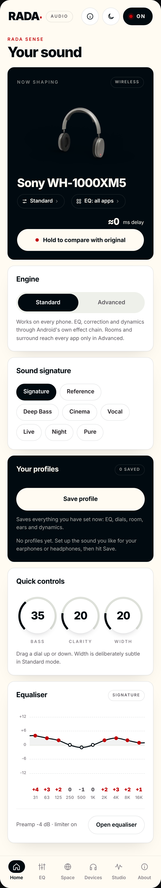
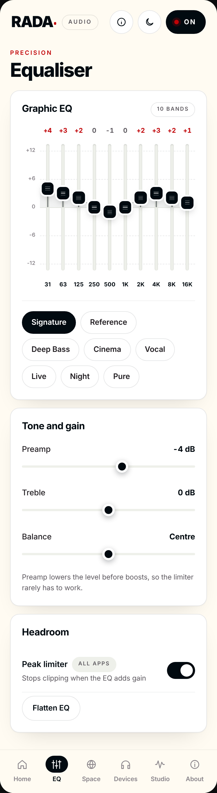
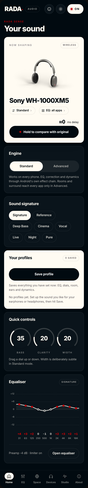

# Rada Audio

Rada Audio shapes the sound of every app on an Android phone: equaliser, sound signatures, rooms, surround and settings for each pair of headphones. It is not a music player. It never records or uploads audio.

Made by **E&C Partners** and **T180** · [ecpartners.co](https://ecpartners.co/)

  

**[Read the manual](docs/MANUAL.md)** · **[Download the latest APK](https://github.com/thetimwork/rada-audio/releases)** · [Changelog](CHANGELOG.md)

## What it does

- **Standard engine** (every phone, no setup): 10-band graphic EQ, eight sound signatures, preamp, treble, balance, bass and clarity dials, stereo width, peak limiter and compressor, applied to every app through Android's own audio effect. Room reverb in this mode reaches apps that share their audio, such as Spotify.
- **Advanced engine** (Android 10+, set up once through [Shizuku](https://shizuku.rikka.app/), no root): captures each app that allows it and runs Rada's own processing (rooms, virtual surround, crossfeed, true mono, warmth, levelling), then mutes the original. Apps that block capture stay on Standard. Stops itself and unmutes everything if capture goes silent.
- **Per-output memory and saved profiles**: each output (Bluetooth, wired, USB DAC, phone speaker) keeps its own sound; save named profiles for headphones, earphones, DACs or speakers.
- **Light and dark**, phone, Fold (closed and open) and tablet layouts.

Not built yet, and marked as such in the app: HRTF spatial, convolution, headphone correction curves, battery and codec readouts, noise-mode control and the hearing check.

## Install

Every push to `main` builds an APK with GitHub Actions and publishes it under **Releases** as a pre-release `alpha-N`. Android 9 (API 28) or later; Advanced mode needs Android 10.

## Build

Android Studio with JDK 17, or:

    ./gradlew assembleDebug

The APK lands in `app/build/outputs/apk/debug/`. Alpha builds are signed with the shared test key in `keystore/` so each build installs over the last; see `keystore/README.md`.

## Repository

```
app/src/main/java/africa/myrada/audio/
  MainActivity.kt          top bar, tabs, permissions, Advanced start/stop
  engine/
    RadaEngine.kt          Standard engine: DynamicsProcessing on the global output, per-app fallback,
                           reverb and virtualiser, settings per output, saved profiles
    EngineService.kt       foreground service, audio-session broadcasts, output changes, capture
    CaptureEngine.kt       Advanced engine: finds playing apps, probes capture, processes, mutes originals
    dsp/                   Freeverb rooms, speaker simulation, crossfeed, mono, warmth, levelling
    Outputs.kt             which output is active, Bluetooth names
    ShizukuBridge.kt       Shizuku permission and the one-time grants
    Settings.kt            settings model and signatures
  ui/                      Compose screens, components, theme, 3D device turntable
app/src/main/assets/devices/   rendered 3D device frames (48 per device)
docs/                      manual and screenshots
tools/devices3d/           Blender scripts that render the device turntables
licenses/                  third-party licences (Figtree font)
```

## Design

Flat, in the Rada brand: Aesthetic White and Rich Black, one Guardsman Red, Figtree throughout, 16 px cards and pill controls. The light/dark switch sits next to the power switch.

Figtree is by Erik Kennedy, under the SIL Open Font License 1.1 (`licenses/Figtree-OFL.txt`).
