# Rada Audio manual

Version 0.1.0 alpha · Android 9 and later (Advanced mode: Android 10 and later)

Rada Audio shapes the sound of every app on your phone: equaliser, sound signatures, rooms, surround and settings for each pair of headphones. Your apps play the music; Rada changes how it sounds. It is not a music player, it never records or uploads audio, and your settings stay on your phone.

> The pictures in this manual come from the Rada Audio design, which the app follows screen for screen. Names such as "Sony WH-1000XM5" and the list of outputs are sample data; on your phone you see your own devices.

## Contents

1. [Install](#1-install)
2. [First start](#2-first-start)
3. [The top bar](#3-the-top-bar)
4. [Home](#4-home)
5. [Equaliser](#5-equaliser)
6. [Sound space](#6-sound-space)
7. [Devices](#7-devices)
8. [Studio](#8-studio)
9. [About](#9-about)
10. [Saved profiles](#10-saved-profiles)
11. [Standard and Advanced engines](#11-standard-and-advanced-engines)
12. [Setting up Advanced mode](#12-setting-up-advanced-mode)
13. [Foldables and tablets](#13-foldables-and-tablets)
14. [Troubleshooting](#14-troubleshooting)
15. [What is not built yet](#15-what-is-not-built-yet)
16. [Privacy](#16-privacy)

---

## 1. Install

1. On your phone, open the project's **Releases** page on GitHub and download the newest `rada-audio-…apk`.
2. Open the file. If Android asks, allow your browser or file manager to install unknown apps.
3. New builds install over old ones and keep your settings and profiles.

## 2. First start

Rada asks for two permissions:

- **Notifications**, so it can show that the sound engine is running. Android keeps the engine alive with this notification.
- **Nearby devices (Bluetooth)**, so the app can show the name of your headphones as they appear in your phone's Bluetooth settings, including a name you gave them yourself.

The engine starts straight away. Play music in any app and adjust from Rada.

## 3. The top bar

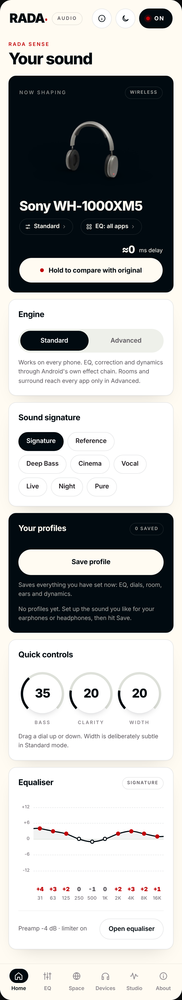

| Control | What it does |
|---|---|
| **RADA• Audio** | The wordmark. On narrow phones the "Audio" pill hides to make room. |
| **ⓘ** | Opens **Engine details**: how sound travels from your apps through Rada to your ears, and whether the phone accepted the system-wide effect. |
| **Moon / sun** | Switches between light and dark. Rada follows your phone's dark theme until you tap it. |
| **ON / OFF** | Starts or stops the sound engine. Off means every app plays untouched. |

Six tabs sit at the bottom on phones, or down the left side on tablets: **Home, EQ, Space, Devices, Studio, About**.

## 4. Home

 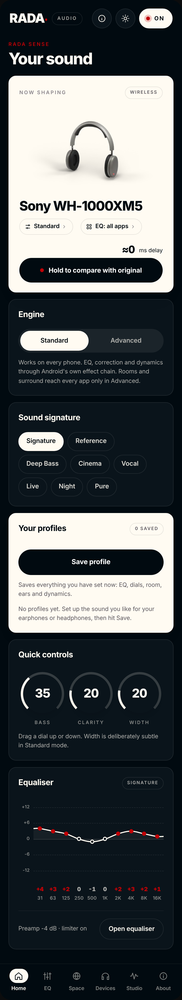

**Device card.** The output Rada is tuning for, shown as a 3D model that turns slowly. Drag it sideways to turn it yourself. It shows headphones, earphones, a USB DAC or the phone speaker, depending on what is connected.

- **Standard / Advanced chip**: the engine in use. Tap it to set up Advanced mode, or, once Advanced runs, to see which apps it is processing.
- **EQ: all apps chip**: how far the equaliser reaches. Tap it for Engine details.
- **Hold to compare with original**: press and hold to hear your music with every Rada effect switched off; let go to hear Rada again.

**Engine.** Choose **Standard** or **Advanced**. See [section 11](#11-standard-and-advanced-engines).

**Sound signature.** Eight starting points for the equaliser:

| Signature | Character |
|---|---|
| Signature | Rada's house sound: fuller lows, lifted detail |
| Reference | Flat |
| Deep Bass | Strong low end |
| Cinema | Lows and presence for films |
| Vocal | Voices forward |
| Live | Open, airy |
| Night | Gentle curve and the compressor on, so quiet and loud parts sit closer |
| Pure | Everything off: flat EQ, no limiter, compressor, reverb or surround |

**Your profiles.** Save the sound you have now. See [section 10](#10-saved-profiles).

**Quick controls.** Three dials, 0 to 100. Drag a dial up or down.

- **Bass** and **Clarity** add to the equaliser curve.
- **Width** changes the stereo image. In Standard mode it is deliberately subtle, because Android lets Rada lean frequencies left and right but not mix the two channels.

**Equaliser.** A chart of the curve you are hearing, with the value of each band. Boosts are marked in red. **Open equaliser** takes you to the EQ tab.

## 5. Equaliser

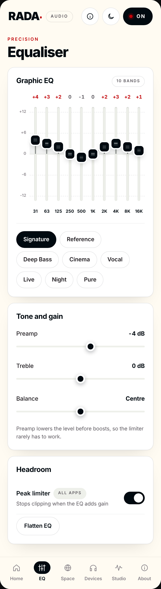

**Graphic EQ.** Ten bands from 31 Hz to 16 kHz, each ±12 dB. Drag a fader cap up or down, or tap anywhere on a track to jump there. The line behind the faders traces the curve through every cap. Choosing a signature below the faders loads its curve; moving a fader makes it **Custom**.

**Tone and gain.**

- **Preamp** (-18 to +6 dB) lowers the level before the equaliser boosts, so the limiter rarely has to work. If the sound distorts when you boost, lower the preamp.
- **Treble** (±12 dB) tilts the top end.
- **Balance** moves the sound left or right.

**Headroom.**

- **Peak limiter** stops clipping when the EQ adds gain.
- **Flatten EQ** sets the faders back to flat (the Reference curve).

## 6. Sound space

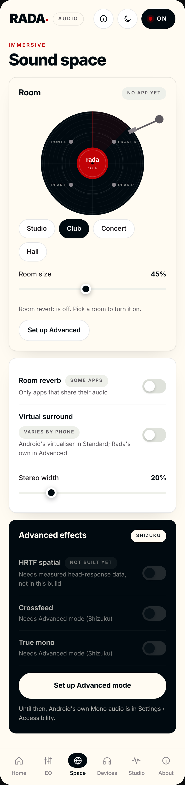 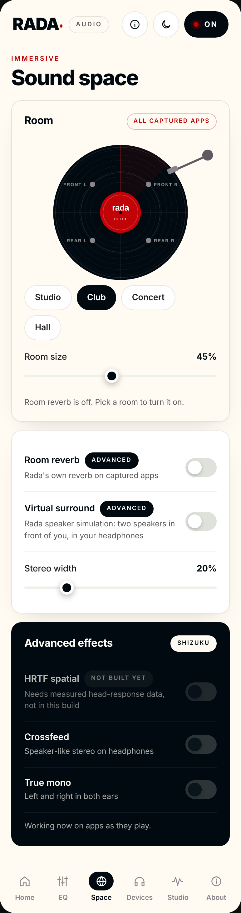

**Room.** The record is Rada's room view: the four dots are speakers, which move outwards as the room grows, and the red line sweeps round while reverb is on.

- **Studio, Club, Concert, Hall**: four rooms from small and dry to large and long. Picking a room switches room reverb on.
- **Room size**: how big the space sounds and how long it rings.
- The tag at the top right says what the reverb is reaching right now.

> **Important.** In Standard mode, room reverb only reaches apps that share their audio with sound apps. Spotify and most music players do. **YouTube and most video apps don't, so in Standard mode rooms cannot reach them.** Advanced mode applies Rada's own reverb to every app that allows capture.

**Room reverb**, **Virtual surround** and **Stereo width** sit underneath.

- **Virtual surround** in Standard mode uses Android's own virtualiser. Phones differ: the line under the switch says whether your phone accepted it. In Advanced mode Rada uses its own speaker simulation instead: two speakers in front of you, in your headphones.
- **Stereo width** works in both modes.

**Advanced effects** (needs Advanced mode):

- **Crossfeed**: lets each ear hear a little of the other channel, as with speakers, so hard-panned sounds stop sitting inside one ear.
- **True mono**: left and right in both ears. Until Advanced is set up, Android's own **Mono audio** is in Settings › Accessibility.
- **HRTF spatial**: marked **Not built yet**.

## 7. Devices

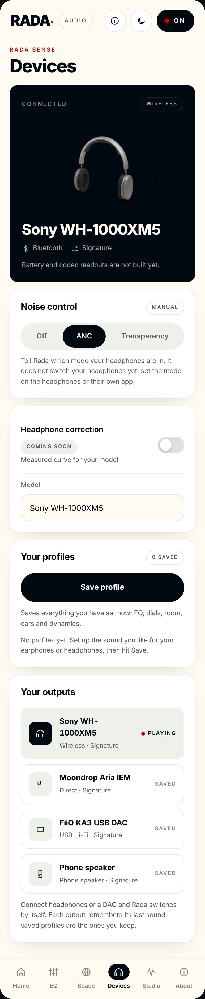

**Device card.** The output that is playing, how it is connected and the sound it is using.

**Noise control** (Bluetooth only, tagged **Manual**). Tell Rada which mode your headphones are in: Off, ANC or Transparency. It does not switch your headphones; set the mode on the headphones or in their own app.

**Headphone correction** is marked **Coming soon**. The model field shows the device name Rada will use for it.

**Your profiles.** The full list, with **Delete**.

**Your outputs.** Every output Rada has tuned: Bluetooth headphones, wired, USB DACs and the phone speaker. Each output remembers its last sound and comes back to it when you reconnect. **Playing** marks the one in use.

## 8. Studio

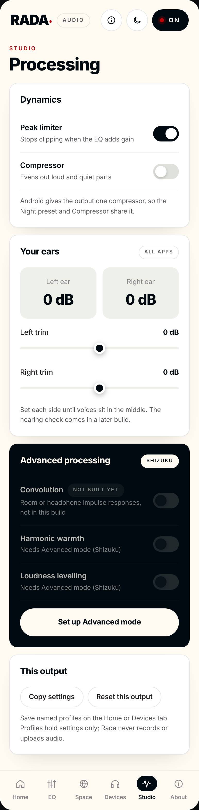

**Dynamics.**

- **Peak limiter** stops clipping.
- **Compressor** evens out loud and quiet parts. Android gives the output one compressor, so the Night signature and this switch share it.

**Your ears.** Trim the left and right ear separately (±12 dB in half steps) until voices sit in the middle. The hearing check comes in a later build.

**Advanced processing** (needs Advanced mode):

- **Harmonic warmth**: gentle valve-style colour.
- **Loudness levelling**: rides the volume slowly so songs and apps end up at a closer level.
- **Convolution**: marked **Not built yet**.

**This output.**

- **Copy settings** puts this output's settings on the clipboard as text.
- **Reset this output** returns it to the defaults.

## 9. About

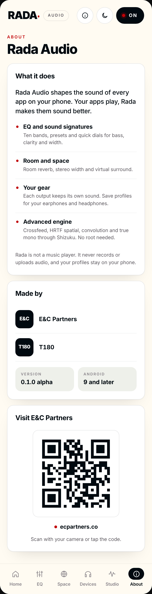

What the app does, who made it (**E&C Partners** and **T180**), the version, and a QR code. Scan it with a camera or tap it to open [ecpartners.co](https://ecpartners.co/).

## 10. Saved profiles

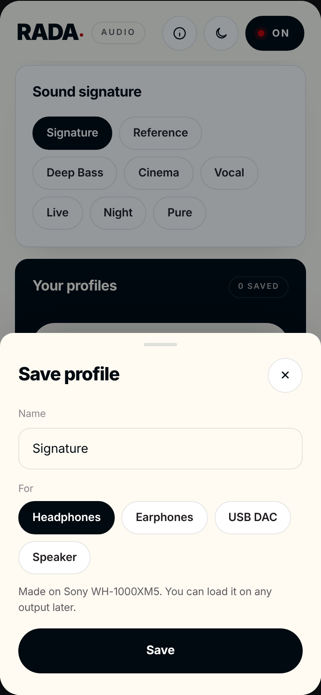 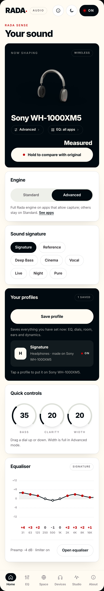

1. Set up the sound you like: equaliser, dials, room, ears and dynamics.
2. Tap **Save profile** on Home or Devices.
3. Give it a name and choose what it is for: **Headphones, Earphones, USB DAC** or **Speaker**. The type is pre-picked from what is connected.
4. Tap **Save**. If a profile of that type already has the name, Rada warns you and **Replace** overwrites it.

Tap a saved profile to put it on the output that is playing now. A profile made on one pair can be loaded on any other. Home shows the newest three; Devices shows them all, each with **Delete**, which asks before deleting.

Separately, each output always remembers its last sound. Saved profiles are the ones you keep on purpose.

## 11. Standard and Advanced engines

**Standard** works on every phone, with no setup. Rada attaches Android's own audio effect to the phone's output, so the equaliser, preamp, balance, limiter, compressor and stereo width reach every app.

- If a phone refuses the system-wide effect, Rada falls back to the apps that share their audio. The EQ chip then says **EQ: some apps**.
- Room reverb reaches only apps that share their audio (see [section 6](#6-sound-space)).
- Virtual surround depends on whether your phone accepts Android's virtualiser.

**Advanced** (Android 10 and later, set up once through Shizuku, no root):

1. Rada finds the apps that are playing.
2. It checks each app actually lets Rada receive its sound. Apps that block capture stay on Standard with the full equaliser.
3. For apps that allow it, Rada takes their sound and runs its own processing: rooms, virtual surround, crossfeed, true mono, warmth and levelling. It plays the result and mutes the app's original sound so you don't hear it twice. The equaliser still applies on top.

Good to know:

- **Delay.** Processed sound arrives a little later, so video can sit slightly behind the picture.
- **Recording indicator.** Android may show its recording indicator while Advanced runs. Rada processes the sound live and does not store or send it.
- **Safety stop.** If capture comes back silent while apps are muted, Rada unmutes everything within about four seconds, stops Advanced and tells you, so an app is never left silent.

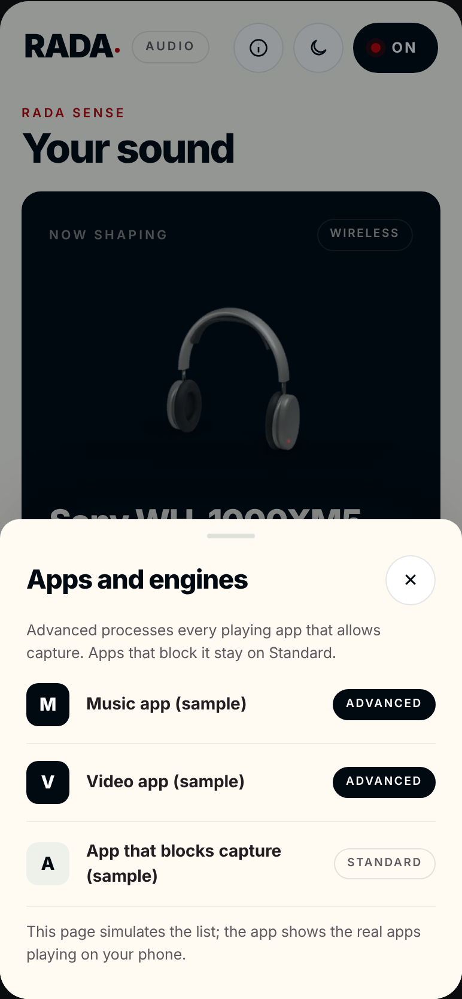 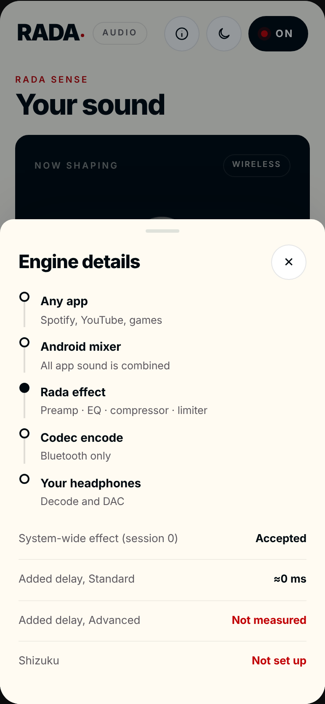

**Apps and engines** (tap the Advanced chip on Home) lists the apps playing and whether each is on Advanced or Standard. **Engine details** (ⓘ in the top bar) shows the path from your apps to your ears.

## 12. Setting up Advanced mode

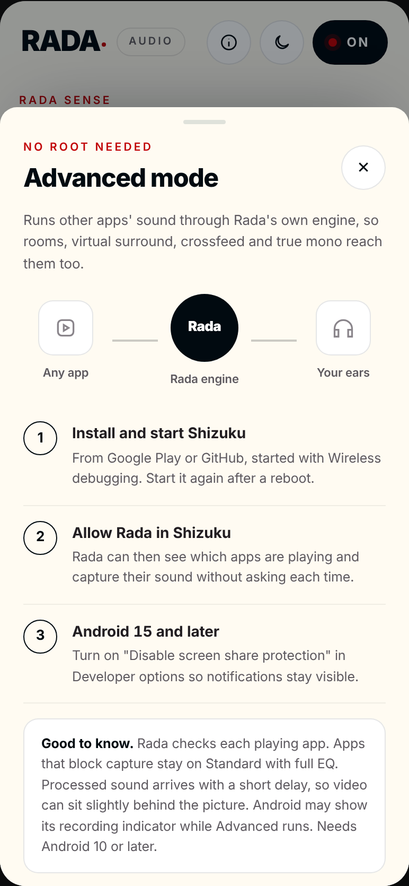

1. **Install Shizuku** from Google Play or GitHub and start it with Wireless debugging, following Shizuku's own instructions. Start it again after every reboot.
2. In Rada, choose **Advanced** on the Engine card, or tap **Set up Advanced** on the Room card.
3. Tap **Open Shizuku** if it is not running yet, then **Allow Rada in Shizuku** and accept Shizuku's prompt.
4. Tap **Grant capture permissions**. Rada uses Shizuku to give itself three things: permission to see which apps are playing, audio capture without a prompt each time, and the record permission that capture needs.
5. Tap **Turn on Advanced**. Android hands over audio capture, normally without a prompt once the permissions are in place.
6. On Android 15 and later, turn on **Disable screen share protection** in Developer options so your notifications stay visible while capture runs.

To leave Advanced, choose **Standard** on the Engine card. Every app goes back to normal at once.

## 13. Foldables and tablets

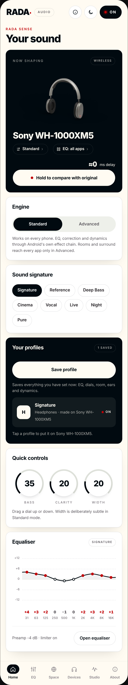 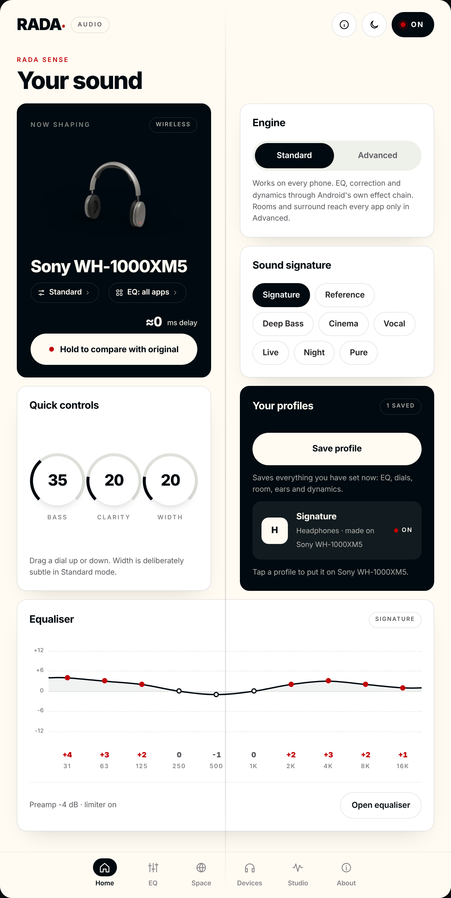

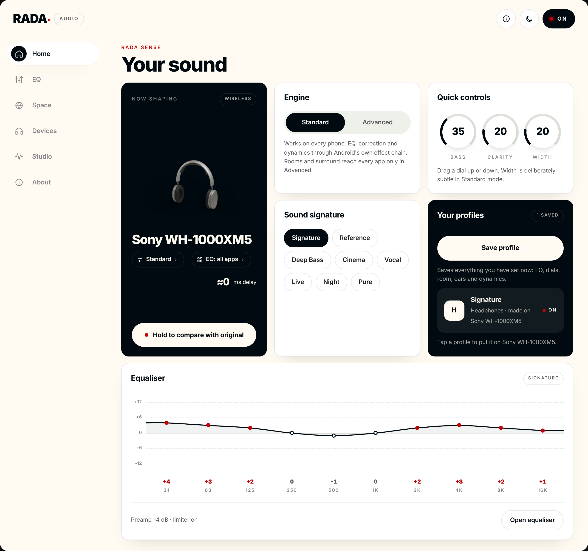
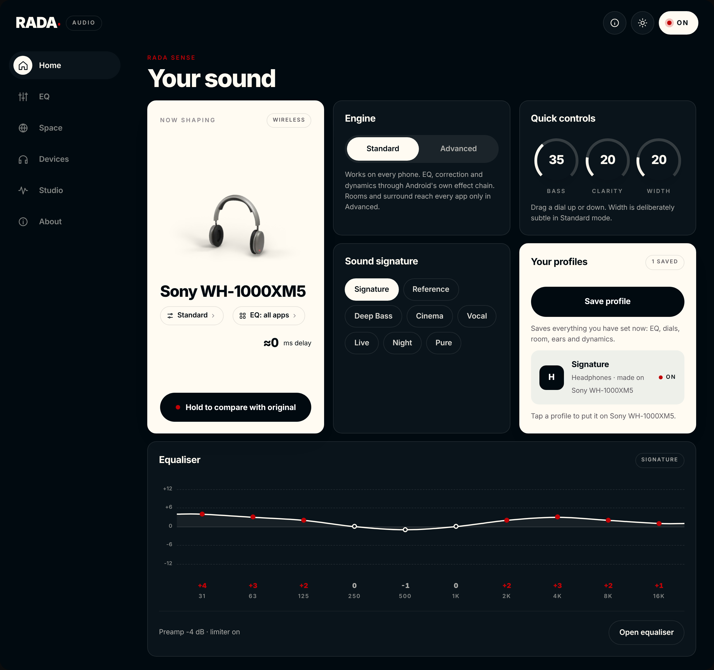

- **Phones and a closed Fold** show one column.
- **An open Fold** shows two columns, with a wider gap so nothing sits on the hinge.
- **Tablets** show three columns, with the tabs down the left.

Cards in a row always share the same height.

## 14. Troubleshooting

**Rooms or reverb make no difference.**
- Check that **Room reverb** is on; picking a room turns it on.
- Look at the tag on the Room card. "No app yet" means the app you are playing does not share its audio. YouTube and most video apps don't. Use Advanced mode for those.

**Virtual surround does nothing.** In Standard mode it is Android's virtualiser, and some phones ignore it; the line under the switch tells you. Advanced mode uses Rada's own.

**The EQ chip says "EQ: some apps".** Your phone refused the system-wide effect. The EQ then reaches only apps that share their audio. Advanced mode reaches every app that allows capture.

**My headphones show a generic name.** Allow **Nearby devices** for Rada in Android's app settings, then reconnect the headphones.

**"This phone returned silence from capture, so Advanced has stopped."** Rada's safety stop. Capture did not deliver sound on your phone, so every app went back to Standard. Choose Advanced again to retry. If it happens every time, Advanced does not work on that phone yet.

**Advanced stopped after a reboot.** Shizuku needs starting again after every reboot. Start it, then choose Advanced again.

**Sound distorts when I boost.** Lower **Preamp** on the EQ tab, and keep **Peak limiter** on.

**Video is slightly behind the picture.** That is Advanced mode's delay. Switch to Standard while watching.

## 15. What is not built yet

Rada marks these in the app rather than pretending they work:

- **HRTF spatial**: needs measured head-response data.
- **Convolution**: room and headphone impulse responses.
- **Headphone correction**: measured curves for your model.
- **Battery and codec readouts** for Bluetooth headphones.
- **Controlling your headphones' noise mode** from Rada.
- **The hearing check** for the ear trims.

## 16. Privacy

Rada processes sound on your phone, live. It does not record, store or upload audio. Saved settings and profiles stay on your phone. Advanced mode's capture is used only to process and play the sound back straight away.

---

Rada Audio is made by E&C Partners and T180. · [ecpartners.co](https://ecpartners.co/)
